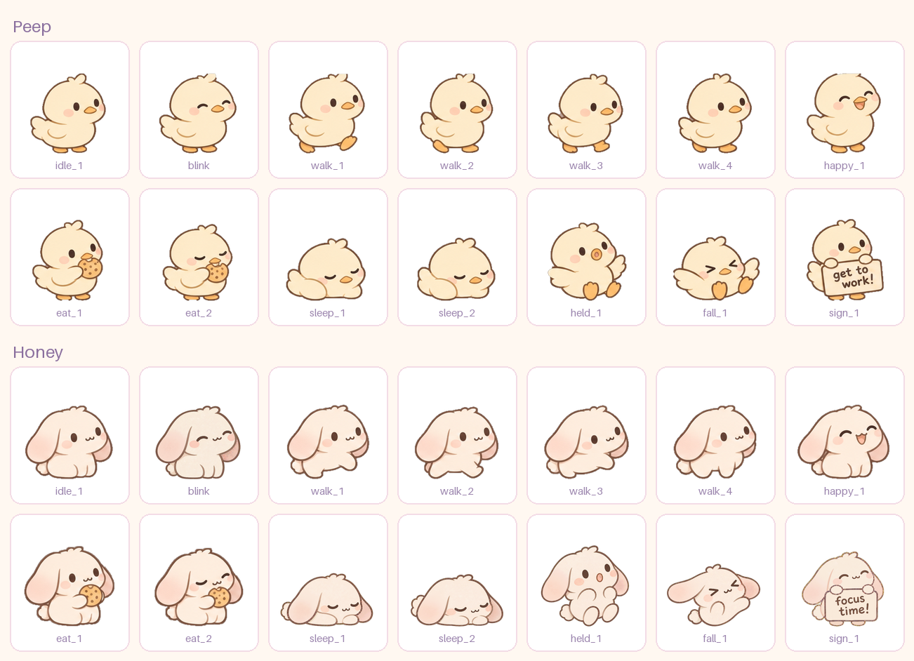

# Peep & Honey 🐥🐰

[](https://github.com/ElizabethKao/focus-pets/actions/workflows/tests.yml)

Desktop pets that learn to help you focus. **Peep** the chick and **Honey** the floppy-eared bunny live at the bottom of your screen. During a focus session they adapt to what you're doing: they stay calm while you work, give a gentle nudge when you drift to a distracting app, and back off when they notice they've become the distraction.

Built in Python with PySide6 (Qt), with a small contextual bandit written from scratch.



## The idea

Most "cute" apps try to maximize engagement. This one tries to do the opposite: **be helpful while interrupting as little as possible.** Silence counts as success if you stay focused, and the pets learn to reduce attention-seeking behavior when it's pulling you away from work.

## How the learning works

During a focus session, the pets' "brain" makes a decision every two minutes, or right away when something happens (you open a distracting app, or you start clicking the pets a lot).

**Context** (what the brain sees):
- category of the active app: productive, neutral, or distracting
- how much you've clicked the pets recently
- how long you've been in the current app
- time since the pets last did something
- time of day
- how far into the session you are

**Actions** (what the pets can do): stay idle, nap, encourage ("you got this!"), hold up a focus sign, nudge ("one task at a time"), retreat to a corner, turn away ("later?"), hide for a few minutes, or do a playful hop.

**Reward** (scored over the two minutes after each action):

| Signal | Effect |
|---|---|
| Time in productive apps | ➕ |
| Time in distracting apps | ➖ |
| Returning to work after a nudge | ➕ bonus |
| Clicking the pets repeatedly (more than once) | ➖ |
| Dragging a pet away | ➖ |
| Hiding a pet from the menu | ➖➖ |
| How disruptive the action itself was (its "interruption cost") | ➖ small |

**Learner:** [LinUCB](https://arxiv.org/abs/1003.0146), a contextual bandit that keeps one small ridge-regression model per action and adds an exploration bonus for actions it's unsure about. It starts from hand-written rules (a "warm start"), so it behaves sensibly on day one, then adjusts to you over time.

**Guardrails:** the bandit only chooses among actions that make sense in the moment. For example, when you're clicking the pets a lot, it can only pick calm back-off actions. It can nudge at most once per visit to a distracting app, and there's a cooldown between interruptions.

You can see what they've learned, and why they made their last decision, from the menu: **What they've learned…**

The code is in `brain.py` (bandit, features, reward, guardrails), `context.py` (app tracking), and `focus.py` (the session loop). The tests in `tests/` include a simulated user whose preferences disagree with the warm-start rules, to check that the bandit actually learns instead of just repeating its starting rules.

## Privacy

The system uses only lightweight local context, such as the active application's category and your interaction history with the pets, without collecting screen content or keystrokes.

- It reads only the name of the app in front (via macOS `NSWorkspace`, no special permissions), and only to sort it into a category.
- It never records screen contents, keystrokes, window titles, messages, or web pages.
- The learning log (`~/.peep/events.jsonl`) stores categories, timestamps, actions, and rewards. **It contains no app names.**
- Nothing is sent anywhere. All data stays in `~/.peep/` on your computer.

Because it can't see websites, browsers count as neutral by default.

## App categories

Choose **Edit app categories…** from the menu to open `~/.peep/apps.json`. Move any app between `productive`, `neutral`, and `distracting`. Changes apply within a few seconds. Spotify is neutral by default, and an app only counts as distracting after it's been in front for 15+ seconds.

## Bedtime

Choose **Bedtime → Set bedtime and wake-up times…** (for example 11:30 PM and 8:00 AM). At bedtime the pets say "it's bedtime! 🌙" and fall asleep. If you keep using your computer, they wake up every 30 minutes to ask "still up?". Clicking a sleeping pet at night just gets a "shh... it's late". In the morning they wake up and say good morning. If your computer was asleep at wake-up time, they wake up as soon as it does. A focus session that runs late postpones bedtime until it ends.

## Battery, storage, and side effects

- **CPU and battery:** the pets animate smoothly only while moving and drop to 10 fps while sitting or sleeping. In testing they used about 1–2% of one CPU core. There are no network calls, sounds, or notifications, and they never keep your Mac awake.
- **Memory:** about 80–90 MB.
- **Storage:** about 6 MB for the project, plus about 700 MB for PySide6 (Qt) in `.venv`. Learning data in `~/.peep` stays under about 1 MB; the log trims itself.
- **Screen:** by default the pets float above normal windows (but not full-screen apps), so they can cover whatever is at the bottom of your screen. Turn off **Stay on top of apps** to have them live on the desktop behind your windows instead. Use **Mini** size, drag them aside, or use **Hide all pets** before a presentation or screen share. They do show up in screenshots and screen recordings.
- **Uninstall:** quit from the menu, delete the folder, and delete `~/.peep`.

## Other things they do

- Waddle, blink, nap with floating z's, and stand on the Dock
- Click for a hop and a heart (just a tiny hop during focus sessions)
- Drag them anywhere and let go to watch them fall
- Finish a focus session to earn a 🍪, then feed it to them. Your streak shows in the menu.
- Sizes: Mini, Tiny, Small, Medium, Large
- **Hide all pets** in one click (handy for presentations)
- Follow your cursor, show or hide each pet, and settings are remembered

## Install and run

Needs Python 3.9+. Works best on macOS; on Windows and Linux the pets work, but app detection is off.

```bash
git clone https://github.com/ElizabethKao/focus-pets.git
cd focus-pets
bash start.sh
```

### Try it out quickly (test mode)

Normally the pets decide every 2 minutes, so it takes a while to see them adapt. Test mode makes everything about 6x faster, adds a 2-minute session, and adds a **Try a behavior** menu that triggers any behavior on demand:

```bash
bash start.sh --test
tail -f peep.log          # watch decisions and rewards live
```

Run the tests:

```bash
QT_QPA_PLATFORM=offscreen .venv/bin/python -m unittest discover tests
```

## Adding or changing art

Put 512×512 transparent PNGs (facing right) in `art/raw/<pet name>/` using the frame names `idle_1`, `blink`, `walk_1`–`walk_4`, `happy_1`, `eat_1`, `eat_2`, `sleep_1`, `sleep_2`, `held_1`, `fall_1`, `sign_1`. Only `idle_1` is required. Then run:

```bash
pip install -r requirements-dev.txt
python tools/prepare_sprites.py
```

The script lines frames up on one ground line and center, matches the sizes and colors of redrawn frames to the idle frame (so poses don't jitter, pulse, or flicker), and writes the app-ready frames to `pets/`.

## Project structure

```
peep.py                    App: menus, wiring
pet.py                     One pet: window, sprite animation, movement state machine
brain.py                   Contextual bandit (LinUCB), features, reward, guardrails
context.py                 Active app category and interaction history
focus.py                   Focus sessions: decide → act → observe → learn; cookies and streaks
bedtime.py                 Bedtime and wake-up schedule
effects.py                 Hearts, sparkles, z's, speech bubbles
default_apps.json          Starting app categories
tools/prepare_sprites.py   Art cleanup pipeline
tests/                     Bandit learning tests and a simulated focus session
```

## Art & AI attribution

- **Concept, behavior and reward design, privacy approach, and creative direction:** Elizabeth Kao
- **Character artwork:** AI-generated with OpenAI's ChatGPT (image generation), based on my character concepts, style direction, and animation requirements
- **AI Coding Assistance:** I used Anthropic's Claude to help debug the macOS window code and to suggest test cases. The learning system (`brain.py`, `focus.py`) and the reward design are my own work.

## License

Code: MIT.
